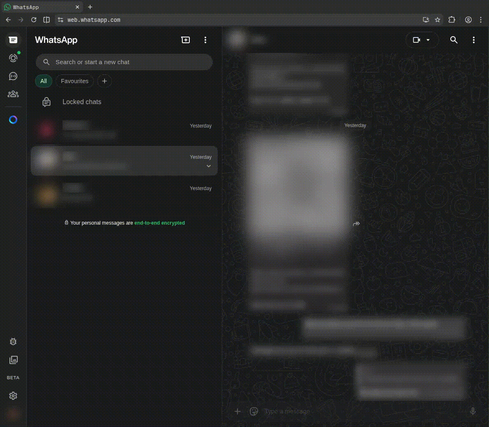

# WWST - WhatsApp Web Sidebar Toggle

A lightweight browser extension to collapse the chat sidebar on WhatsApp Web.

## How it Works

- **Collapse:** Click the chat tab to hide the left sidebar.
- **Restore:** Click the same tab again to bring it back.

### Hotkeys

- **Default:** `Ctrl + B` (Windows/Linux) or `Cmd + B` (Mac)
- **Customize:** Click the shortcut in the popup, then press a new combination.
  Include `Ctrl`, `Cmd`, or `Alt` so the shortcut is not triggered by regular
  typing.
- By default, the hotkey works even while you are typing. You can change this in
  the extension popup.

## Popup

Click the extension icon in the toolbar (pin it from the extensions menu if
needed) to configure:

- **Shortcut** — click the keycaps in the header and press a new combination.
  `Ctrl`/`Cmd` is treated as the primary modifier, so the shortcut follows the
  platform you are using.
- **Ignore while typing** (default: off) — prevents your shortcut from toggling
  the sidebar while the cursor is in a text field, such as the message composer.
  Enable this if you use the shortcut to make text bold.

## Installation

### Chrome / Edge / Brave

1. Clone or download this folder.
2. Go to `chrome://extensions/` (or your browser's equivalent).
3. Enable "Developer mode" in the top right.
4. Click "Load unpacked" and select the directory containing the `manifest.json` and `content.js` file.

### Firefox

1. Clone or download this folder.
2. Go to `about:debugging#/runtime/this-firefox`.
3. Click "Load Temporary Add-on" and select the `manifest.json` file.

